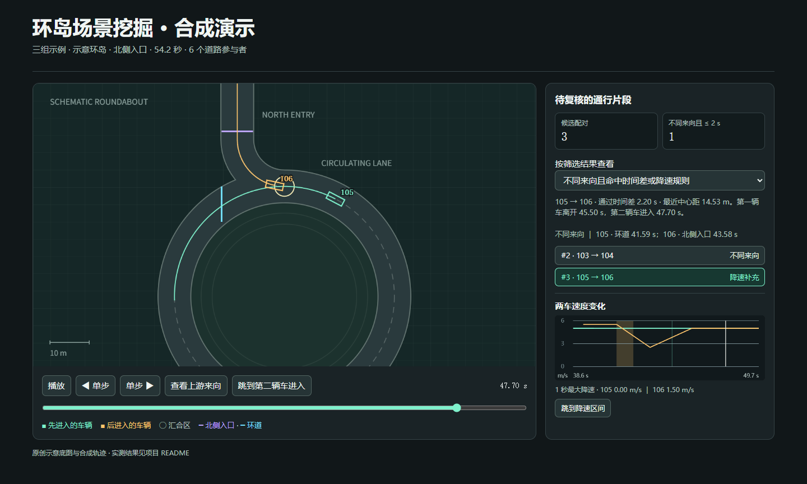

# 真实环岛交通冲突挖掘与回放

从 OpenDD 航拍轨迹中找出先后通过同一汇合区的车辆配对，比较两种粗筛规则。选中候选片段即可回到现场，查看车辆轨迹、通过时刻和最近中心距。

## 先看回放



[在线交互演示](https://dengjilou.github.io/roundabout-conflict-mining/) · [实测报告](review.md#降速证据与最终对照) · [离线演示 HTML](docs/index.html)

下载 HTML，用浏览器打开即可。合成演示用原创底图和程序生成的轨迹展示三种情况：同路短间隔、不同来向短间隔、超过 2 秒但出现明显降速的汇入。选中 **#3**，点击「跳到降速区间」或直接点击速度图，地图会跳到同一时刻。

需要从源码重建演示时，运行 `python build_demo.py output/portfolio-build`。GitHub Pages 可直接使用 `main` 分支的 `/docs` 目录。

## OpenDD 实测摘要

在 rdb5 的一个观测区域，回放同时显示车辆来向、穿线时刻和两车速度曲线。在冻结规则后的 30 段记录中，88 组配对里有 6 组通过「不同来向且间隔不超过 2 秒」的筛选。加入降速证据后，待复核清单增加 1 组。[完整报告与复现命令](review.md#降速证据与最终对照)

## 本地复现

需要 Python 3.10 或更新版本及浏览器。脚本使用 Python 标准库。下载 [OpenDD example_data](https://data.l3pilot.eu/OpenDD/opendd_v3-example_data.zip) 到 `data/example.zip`。

```powershell
python -m zipfile -e data/example.zip data/example
python mine.py data/example/example_data/rdb1_4.sqlite data/example/example_data/geo-referenced_images_rdb1/rdb1.png output/example
python -m unittest -v
```

用浏览器打开 `output/example/replay.html`。页面支持时间轴、候选筛选、跳到第二辆车进入圆区，以及约 0.1 s 的显示单步。计算使用原始观测帧，底图通过 world file 的六项仿射系数定位。`report.json` 记录事件时刻与指标。`review.csv` 留有事件复核和备注列。

## 方法

1. 在底图上划定半径 2.5 m 的圆形汇合区，用相邻观测之间的直线估算车辆中心跨越圆区边界的时刻。观测缺口大于 0.12 s 时要求重新观察完整的进出过程。
2. 将有完整进出记录的不同车辆配对。第二辆进入的时刻至多比第一辆离开晚 5 s。
3. 在配对的通行窗口前后各扩 1 s，取共同观测帧上的最小中心距。距离法要求该值不超过 5 m。时间差法要求第一辆离开至第二辆进入相隔 0–2 s。圆区占用重叠单独记录。

这里用车辆中心与人为划定的区域计算通过时间差，是对 PET（Post-Encroachment Time，侵入后时间）的近似。阈值用于粗筛。车身净距、急刹和事件严重度需要额外证据。

## 实测结果

| 记录 | 完整通行 | 配对 | 两法均检出 | 仅距离 | 仅时间差 | 两法均未检出 |
| --- | ---: | ---: | ---: | ---: | ---: | ---: |
| 开发样本 `rdb1_4`，约 9.3 分钟 | 118 | 131 | 0 | 1 | 40 | 90 |
| 跨地点检验 `rdb5_333`–`rdb5_342`，约 77.2 分钟 | 93 | 13 | 0 | 0 | 5 | 8 |

在 rdb5 依据底图布置西北侧汇合区，沿用开发时的半径和时间、距离阈值。留出组按编号选取连续十段，每段整段读取。该区域留出组只有 13 个配对，当前结果反映规则检出差异，准确率和召回率需要完整标注。

- `rdb1_4` #45，车辆 924 于 207.818 s 离开，车辆 926 于 208.421 s 进入。通过时间差 0.603 s，最近中心距 6.776 m。回放可看到车辆 926 从东侧入口驶入。
- `rdb1_4` #18，最近中心距为 4.951 m，发生在 96.597 s，比第二辆离开圆区晚约 0.967 s。通过时间差为 2.178 s。距离规则也会检出圆区之外、仍在观测窗口内的靠近。
- `rdb5_334` #1，通过时间差 1.290 s，最近中心距 10.038 m。两辆车在观测圆区顺次通行。回看上游轨迹，第一辆车来自北侧入口，第二辆车此前已在环道内。

[查看候选复核、来向识别与 20 段独立记录验证](review.md)。

下载 [OpenDD rdb5](https://data.l3pilot.eu/OpenDD/opendd_v3-rdb5.zip) 到 `data/rdb5.zip` 后可复现留出检验。

```powershell
python -m zipfile -e data/rdb5.zip data/holdout
$db = 'data/holdout/rdb5/trajectories_rdb5_v3.sqlite'
$map = 'data/holdout/rdb5/geo-referenced_images_rdb5/rdb5.png'
333..342 | ForEach-Object {
    python mine.py $db $map "output/rdb5_$_" --recording "rdb5_$_" --report-only
    if ($LASTEXITCODE -ne 0) { throw "Failed to process recording $_" }
}
python mine.py $db $map output/holdout-334 --recording rdb5_334
```

## 数据来源

Breuer, Termöhlen, Homoceanu and Fingscheidt, *openDD: A Large-Scale Roundabout Drone Dataset*, IEEE ITSC 2020. 可从官网取得底图和轨迹，在本机生成叠加回放。[OpenDD v3 数据说明](https://l3pilot.eu/data/opendd.html) · [数据许可 CC BY-ND 4.0](https://creativecommons.org/licenses/by-nd/4.0/)
